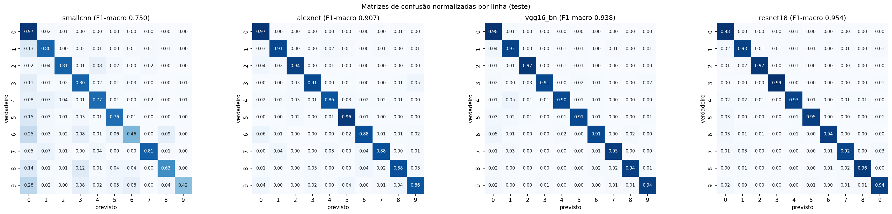
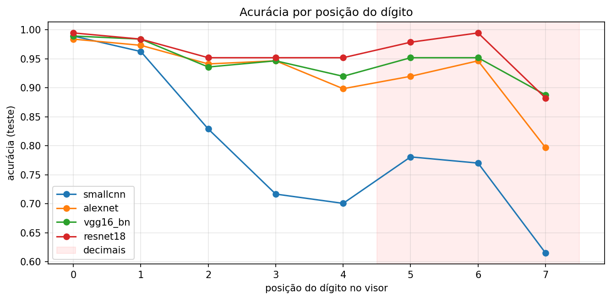
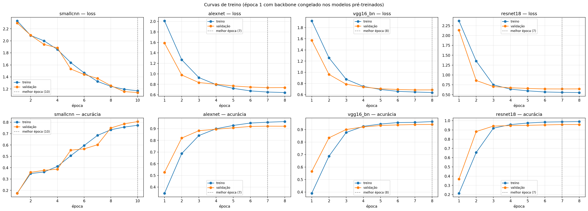
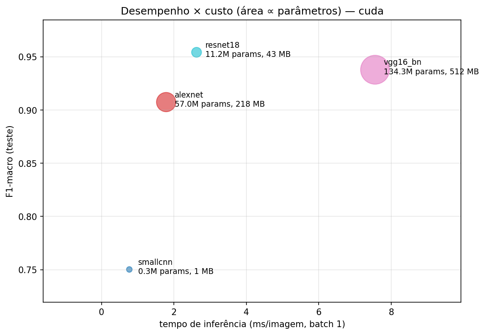

# Pedro Soares Pereira e João Pedro Lins — Classificação de Dígitos de Hidrômetros com AlexNet, VGG16 e ResNet

**Disciplina:** Visão Computacional (VC001) — CESAR School, 2026.2
**Integrantes:** Pedro Soares Pereira (psp2@cesar.school) · João Pedro Lins (jplld@cesar.school)

## Fonte dos dados e licença

Dataset: [Yandex.Toloka Water Meters](https://www.kaggle.com/datasets/tapakah68/yandextoloka-water-meters-dataset),
licença **CC BY-NC-ND 4.0**. Este repositório **não** contém imagens do dataset, recortes gerados nem checkpoints.
O uso é restrito a fins acadêmicos e não comerciais.

## Arquivos

| Arquivo | Conteúdo |
|---|---|
| `app.ipynb` | Notebook com as Partes 1–5, executado no Colab (saídas com imagens do dataset removidas) |
| `splits.csv` | Divisão oficial treino/validação/teste fornecida pelo professor (não alterada) |
| `results.csv` | Métricas no conjunto de teste, uma linha por modelo |
| `history_*.csv` | Histórico de treino de cada modelo |
| `figures/` | Matrizes de confusão, acurácia por posição, curvas de treino e desempenho × custo |
| `ROTEIRO.md` | Roteiro original da prática |

## Como reproduzir

**Google Colab (ambiente usado nos resultados):**

1. Abrir `app.ipynb` no Colab e escolher *Ambiente de execução → Alterar o tipo de ambiente → T4 GPU*.
2. Em *Secrets* (ícone de chave), criar `KAGGLE_API_TOKEN` com o token da API do Kaggle e liberar o acesso ao notebook.
3. *Executar tudo*. A primeira célula pede o upload do `splits.csv` oficial; o dataset é baixado pela API do Kaggle.
4. A última célula empacota `results.csv`, `history_*.csv` e `figures/` em `entrega.zip`.

**Local:**

```bash
python -m venv .venv && .venv\Scripts\activate          # Windows (Linux/macOS: source .venv/bin/activate)
pip install -r requirements.txt
# token da API do Kaggle em ~/.kaggle/access_token
jupyter notebook app.ipynb                               # executar todas as células
```

- Ambiente usado: Google Colab, GPU **Tesla T4**, PyTorch 2.11.0+cu130.
- Tempo de treino (soma das épocas, sem validação): smallcnn 32 s · alexnet 27 s · vgg16_bn 345 s · resnet18 68 s (≈ 8 min no total).
- Split utilizado: `splits.csv` **oficial** fornecido pelo professor (não alterado).
- Se já existirem checkpoint e histórico de um modelo, o notebook pula o treino dele (`RETRAIN = False`).

## Preparação dos dados

- Rótulo de 8 dígitos tirado do **nome do arquivo**: parte inteira completada com zeros à esquerda até 5 dígitos e parte decimal com zeros à direita até 3. **1243** imagens válidas e **1** descartada (`id_664_value_45_2676.jpg`, 4 casas decimais).
- Visor retificado em uma faixa **384×64** por transformação de perspectiva do retângulo mínimo (`minAreaRect`) do polígono anotado, com o lado maior como eixo horizontal.
- Correção de orientação: visores **verticais** são endireitados pela geometria; visores **de cabeça para baixo** são girados 180° quando as 3 primeiras posições são mais vermelhas que as 3 últimas (vermelhidão `R − max(G, B)`, com diferença ≥ 1,5 e diferença relativa ≥ 0,2), já que os dígitos decimais são vermelhos.
- Faixa dividida em **8 recortes 48×64**, salvos em `digits/{split}/{digito}/{image_id}_{posicao}.png`, com índice em `digits/index.csv`. Verificações: **9944** recortes e nenhuma imagem em mais de um split.

## Protocolo de treino

| Modelo | Pesos | Entrada | Batch | LR cabeça | LR backbone | Épocas máx. | Melhor época |
|---|---|---|---|---|---|---|---|
| smallcnn | do zero | 64×48 | 256 | 1e-3 | — | 10 | 10 |
| alexnet | ImageNet (IMAGENET1K_V1) | 128×128 | 128 | 1e-3 | 1e-4 | 8 | 7 |
| vgg16_bn | ImageNet (IMAGENET1K_V1) | 128×128 | 32 | 1e-3 | 1e-5 | 8 | 8 |
| resnet18 | ImageNet (IMAGENET1K_V1) | 128×128 | 128 | 1e-3 | 1e-4 | 8 | 7 |

Comum aos quatro: `AdamW` + `OneCycleLR` (passo a passo), `CrossEntropyLoss(label_smoothing=0.1)`, 1ª época com backbone congelado (modelos pré-treinados), *early stopping* pelo F1-macro de validação com paciência 3, `seed=42` (cuDNN determinístico), augmentation `RandomAffine(degrees=5, translate=(0.05, 0.05), scale=(0.95, 1.05))` + `ColorJitter(brightness=0.3, contrast=0.3)` sem flip, normalização com média e desvio do ImageNet. Nenhum modelo parou por *early stopping*.

Alterações em relação ao protocolo oficial (todas valem para os quatro modelos):

- **Treino em fp32.** Com mixed precision (fp16), a loss deu `NaN` desde a 1ª época na GPU local (GTX 1650, problema conhecido da série 16xx), por isso o AMP foi desligado.
- **Augmentation na GPU, por lote.** Mesmos intervalos de `RandomAffine` e `ColorJitter`, com parâmetros sorteados por amostra, mas aplicados com `affine_grid`/`grid_sample` na GPU. Feita imagem a imagem na CPU, ela era o gargalo do treino.
- **Definição de cabeça e backbone.** A cabeça é só a camada linear final substituída (10 classes); todo o resto, inclusive as camadas densas pré-treinadas da AlexNet e da VGG16, é backbone. Na `smallcnn`, todos os parâmetros usam a LR da cabeça.

## Resultados (conjunto de teste)

| model | acc_digit | f1_macro | acc_reading | params_M | s_per_epoch | ms_per_image | ckpt_MB | best_epoch |
|---|---|---|---|---|---|---|---|---|
| smallcnn | 0.7955 | 0.7502 | 0.2834 | 0.2887 | 2.885 | 0.769 | 1.1177 | 10 |
| alexnet | 0.9258 | 0.9075 | 0.6257 | 57.0448 | 3.5801 | 1.7846 | 217.6142 | 7 |
| vgg16_bn | 0.9459 | 0.9379 | 0.7166 | 134.31 | 47.3884 | 7.5516 | 512.4149 | 8 |
| resnet18 | 0.9612 | 0.9543 | 0.7968 | 11.1816 | 9.2626 | 2.6246 | 42.7302 | 7 |

`s_per_epoch` e `ms_per_image` foram medidos na GPU T4 do Colab (`ms_per_image`: batch 1, mediana de 200 execuções após 20 de aquecimento).

Figuras (pasta `figures/`):

- Matrizes de confusão normalizadas: `figures/confusion_matrices.png`
- Acurácia por posição: `figures/accuracy_by_position.png`
- Curvas de treino: `figures/training_curves.png`
- Desempenho × custo: `figures/performance_vs_cost.png`






## Respostas às questões

**1.1**

**images/**: 1244 fotos .jpg de resoluções variadas (a maioria tem 1333×1000; a menor, 480 px; a maior, 2168 px).

**masks/**: 1244 máscaras do visor, com a mesma resolução da foto. O visor ocupa só ~2% da imagem (mediana). Como são .jpg, têm 3–4 tons em vez de só preto e branco.

**collage/**: a foto com o polígono desenhado por cima. É só visualização, não traz informação nova.

**data.csv:**
  - photo_name: o nome do arquivo, que contém o id e a leitura;
  - value: a leitura em m³, guardada como número decimal;
  - location: o polígono do visor, com 4 a 8 pontos em coordenadas normalizadas.

Para treinar: images/ com o rótulo (nome do arquivo ou data.csv) e a localização do visor (polígono ou máscara, que são equivalentes). A collage/ não serve.

**1.2**

É por imagem, uma leitura interia por foto. Isso implica que cada rótulo da imagem precisa ser derivado. Isso exige 3 coisas: 1 - o visor se divide em 3 partes iguais, 2 - a string da leitura pode ser completada em até 8 dígitos, 3 - a orientação foi corrigida.

**2.1**

A coluna **value**, que é decimal -> 300 linhas têm ruído de arredondamento (ex.: 305.16200000000003);
128 linhas perderam zeros à direita.
O nome do arquivo guarda os dígitos como texto. Ele também perde zeros à direita (95_22), mas a imagem confirma que o visor mostra 00095220. Então a regra "completar a parte inteira com zeros à esquerda até 5 dígitos e a parte decimal com zeros à direita até 3" recupera o rótulo.

**Limitação dela:** 36 imagens com decimal "0" são visores de 5 dígitos, em que o rótulo de 8 dígitos não corresponde ao visor. E 1 imagem tem 4 casas decimais.

**2.2**

0: 35,7% dos recortes (3549 de 9944). O segundo é o 1, com 10,1%.
Motivo: zeros à esquerda. A leitura mediana é 188,8 m³, e 817 imagens têm parte inteira de 3 dígitos. A posição 0 é zero em 100% das imagens, a posição 1 em 96% e a posição 2 em 32%. Da posição 3 em diante, os dígitos ficam quase uniformes (~10% cada).
Implicação: a base é desbalanceada, por isso o F1-macro é a métrica certa.

**3.1**

Os 8 recortes de uma foto compartilham hidrômetro, fonte, iluminação, fundo e desfoque. Se recortes da mesma foto estivessem no treino e no teste, o modelo "reconheceria o hidrômetro" e o teste ficaria otimista (data leakage).

A acc_reading também exige os 8 recortes da imagem no mesmo split.

O mesmo splits.csv para todos garante comparação justa entre os modelos e entre os grupos, e impede escolher um split favorável.

**3.2** Quantidade de faixas corrigidas: **118**.

- 105 verticais (rotação de 90°);
- 54 giradas 180°, das quais 41 eram verticais e 13 eram horizontais de cabeça para baixo.

Tipos de erro, com quantidades:

- **Visor de 5 dígitos:** 36 imagens, 288 recortes desalinhados do rótulo. No teste (4 imagens), os modelos pré-treinados acertam só 53–56% desses recortes.
- **Orientação ambígua (sem vermelho para decidir):** 39 faixas. Em 37 faixas conferidas à mão, 2 estavam erradas (1227_0 e 509_0, ambas sem vermelho). No teste (7 imagens), a acurácia nesse grupo é de 68–75%.
- **Desalinhamento pela divisão em larguras iguais:** recortes com meio dígito, com o vizinho ou com a vírgula. Isso não foi contado diretamente.
- **Dígito rolando na última posição decimal:** a acurácia na posição 7 é 0,88 na ResNet18, contra 0,95–0,99 nas outras posições.

**3.3**

A divisão supõe que os 8 dígitos são igualmente espaçados e preenchem o polígono inteiro. Isso falha por vários motivos:
- margens do polígono;
- a vírgula e as janelas vermelhas com espaçamento diferente;
- perspectiva: o minAreaRect não corrige a perspectiva, então os dígitos do lado mais distante ficam mais estreitos;
- visores de 5 dígitos.

O deslocamento se acumula e piora nas pontas.
Como corrigir:
- usar o perfil de projeção vertical ou componentes conexos para achar os espaços entre os tambores;
- fazer a homografia com os 4 cantos reais do polígono (approxPolyDP) em vez do retângulo mínimo;
- detectar se o visor tem 5 ou 8 dígitos;
- ou não cortar: usar um modelo de sequência (CRNN com CTC). Esse é o desafio extra.

**4.1**

Os pesos pré-treinados foram aprendidos com entradas normalizadas por essa média e esse desvio padrão. Os filtros da 1ª camada e as estatísticas de BatchNorm meio que esperam essa distribuição. Sem a normalização, as ativações ficam deslocadas e as features perdem sentido.

*A smallcnn usou a mesma normalização só para manter o protocolo idêntico.

**4.2**

| model | params_M | conv_M | fc_M | fc_% | 1ª_linear_M |
|---|---|---|---|---|---|
| smallcnn | 0.289 | 0.287 | 0.001 | 0.447 | 0.001 |
| alexnet | 57.045 | 2.470 | 54.575 | 95.671 | 37.753 |
| vgg16_bn | 134.310 | 14.723 | 119.587 | 89.038 | 102.765 |
| resnet18 | 11.182 | 11.177 | 0.005 | 0.046 | 0.005 |

- Na AlexNet e na VGG16, quase todos os parâmetros estão na 1ª camada densa.
- A ResNet usa global average pooling, então quase não tem camada densa.
- O tamanho do checkpoint acompanha os parâmetros: 1, 43, 218 e 512 MB.

**4.3**

**Só a cabeça:** as features ficam fixas, as do ImageNet, e só o classificador novo aprende.
**Fine-tuning:** a rede inteira se adapta aos dígitos, com LR menor no backbone.

Os números mostram a diferença. F1 de validação na época 1, com backbone congelado:
- AlexNet 0,36, VGG16 0,38, ResNet18 0,08.

Na época 2, já descongelado: 0,76, 0,79 e 0,85. No final: 0,90, 0,93 e 0,95.

Por que congelar só na 1ª época: a cabeça começa aleatória, e os gradientes grandes do começo destruiriam as features pré-treinadas. Primeiro a cabeça "aquece", depois a rede toda se adapta, porque dígito de hidrômetro está longe do domínio do ImageNet.

**4.4**

- O flip horizontal cria símbolos que não existem (2, 3, 5 e 7 espelhados).
- O flip vertical ou a rotação de 180° troca 6↔9 e inverte a ordem e a posição das casas decimais.
- Hidrômetros nunca aparecem espelhados. A augmentation deve imitar variações plausíveis, por isso a rotação é só de ±5°.

**5.1**

ResNet18, com F1 = 0,954.
O ranking é o mesmo da acurácia (ResNet > VGG > AlexNet > smallcnn), mas a diferença entre acurácia e F1 varia:
- smallcnn: acurácia 0,796 contra F1 0,750 (4,5 pontos);
- pré-treinados: 1–2 pontos.

Explicação: a smallcnn favorece o 0 (recall de 0,967 no 0, mas só 0,42 no 9 e 0,46 no 6). A classe majoritária infla a acurácia, e o F1-macro pesa todas as classes igualmente.

**5.2**

Os mais frequentes: 6→0 (41), 1→0 (34), 9→0 (31), 5→0 (20), 8→0 (19), 4→1 (18), 8→3 (17).
Possíveis causas:
- viés para a classe majoritária;
- 9→0 é a transição do tambor (o 9 "rola" para o 0);
- 6, 8, 9 e 0 têm laços fechados parecidos;
- 4/1 compartilham o traço vertical, e 8/3 têm a metade direita igual;
- recortes desalinhados mostram meio dígito.

**5.3**

A leitura exige os 8 dígitos certos ao mesmo tempo. Se os erros fossem independentes, a acurácia de leitura seria acc⁸:
- ResNet18: 0,961⁸ ≈ 0,73 (observado: 0,797);
- VGG16: 0,64 (0,717); AlexNet: 0,54 (0,626); smallcnn: 0,16 (0,283).
- O valor observado é maior que o previsto porque os erros se concentram em imagens difíceis: várias falhas na mesma foto.
- A posição 7 é o elo fraco (0,88).
- Sem os 4 visores de 5 dígitos do teste, a acc_reading da ResNet sobe para 0,814.

**5.4**

ResNet18:
- melhor F1 (0,954) e melhor acc_reading (0,797);
- 11,2 M parâmetros e 43 MB de checkpoint (contra 512 MB da VGG);
- 2,6 ms por imagem.
- A smallcnn é minúscula (1 MB, 0,77 ms), mas acertar 28% das leituras é inaceitável.
- Ressalva: o tempo foi medido numa GPU T4, não num celular. Lá a ordem de custo deve ser parecida, mas os valores absolutos, não.

**5.5**

Conexões residuais, BatchNorm e global average pooling resultam em:
- 12× menos parâmetros (11,2 contra 134,3 M) e checkpoint 12× menor;
- inferência 2,9× mais rápida (2,6 contra 7,6 ms);
- época de treino 5× mais rápida (9,3 contra 47,4 s);
- desempenho melhor: F1 0,954 contra 0,938, e leitura 0,797 contra 0,717;
- convergência mais rápida: F1 de validação de 0,93 na época 3, contra 0,88 da VGG.
- Ressalva honesta: a VGG usou LR de backbone 10× menor (1e-5, pelo protocolo), então nem toda a diferença é da arquitetura.

**5.6**

**Não:** F1 de 0,750 contra 0,954.

Mas as curvas mostram underfitting, não falta de capacidade:
- a melhor época foi a última (10);
- o F1 de validação ainda subia (0,65 → 0,73 → 0,75 nas 3 últimas épocas);
- a acurácia de treino (0,77) ficou abaixo da de validação (0,81);
- nas 4 primeiras épocas ela só chutava "0" (F1 ≤ 0,10).

**O que isso indica:** 10 épocas não bastam para treinar do zero. O pré-treino dá uma vantagem enorme de partida (a AlexNet chega a F1 de 0,76 já na 2ª época). Com 39× menos parâmetros, a smallcnn provavelmente fecharia parte da diferença com mais épocas.

## Limitações

> **Rascunho gerado com IA — revisar e reescrever com as palavras do grupo antes da entrega.**

**O que o pipeline faz de errado e por quê.**

- *Rótulos.* O rótulo vem do nome do arquivo, que perde zeros à direita; a regra de preenchimento corrige a maior parte dos casos, mas 36 imagens são visores de 5 dígitos, em que o rótulo de 8 dígitos não corresponde ao visor (288 recortes com rótulo errado).
- *Orientação.* A correção de 180° depende da cor vermelha dos decimais; em 39 faixas sem vermelho a decisão fica só pela geometria, e a inspeção manual encontrou erros justamente nesse grupo.
- *Divisão da faixa.* As 8 larguras iguais ignoram margens, vírgula e perspectiva (o `minAreaRect` não corrige trapézios), gerando recortes deslocados.
- *Dígitos em transição.* Na última posição decimal o tambor costuma estar entre dois números, e o rótulo escolhe um deles; a posição 7 é a pior em todos os modelos.

**Quanto do erro vem dos dados e quanto do modelo.**

- **Recortes com problema identificado** (visor de 5 dígitos, orientação ambígua ou faixa corrigida; os grupos se sobrepõem):
  - são 160 dos 1496 recortes de teste (10,7%);
  - concentram 17 dos 58 erros da ResNet18 (29%);
  - taxa de erro de 10,6%, contra 3,1% nos demais recortes.
- **Os outros 41 erros** estão em recortes sem problema identificado. Parte deles ainda pode vir do pipeline (desalinhamento da divisão em larguras iguais, dígito em transição na posição 7), o que não foi quantificado.
- **Conclusão para o melhor modelo:** os dados explicam uma fração desproporcional do erro, mas não a maioria.
- **Na `smallcnn`, o modelo pesa mais:** ela erra 20% de todos os recortes, por causa do treino curto (10 épocas, ainda melhorando) e do viés para a classe 0.

**Limites da avaliação.**

- Uma única seed: não há medida de variância, e as diferenças pequenas (VGG16 × ResNet18) podem não ser significativas.
- Teste pequeno (187 imagens): cada leitura vale 0,5 ponto de `acc_reading`.
- Tempos medidos numa GPU T4, não no hardware de um celular.
- O protocolo usa LRs de backbone diferentes (1e-5 na VGG16), o que mistura efeito de arquitetura e de hiperparâmetro.

**O que mudaríamos.**

- Detectar visores de 5 dígitos e excluí-los ou rotulá-los corretamente.
- Dividir a faixa pelo perfil de projeção vertical em vez de larguras iguais.
- Usar homografia com os 4 cantos reais do polígono.
- Treinar a `smallcnn` por mais épocas.
- Repetir os treinos com várias seeds.

## Declaração de uso de IA

A declaração de uso de IA, preenchida no template oficial da disciplina, está em
[`Declaracao_Uso_IA_Pratica2_VC.docx`](Declaracao_Uso_IA_Pratica2_VC.docx).

Resumo: o assistente **Claude Opus 5.5** (`claude-opus-5-5`), via Claude Code, gerou o código do notebook, diagnosticou os problemas de execução e propôs os tópicos de análise com os números do experimento; as respostas às questões seguem de perto esse texto. Não foram usados skills (SKILL.md) nem SDD na elaboração da prática.
